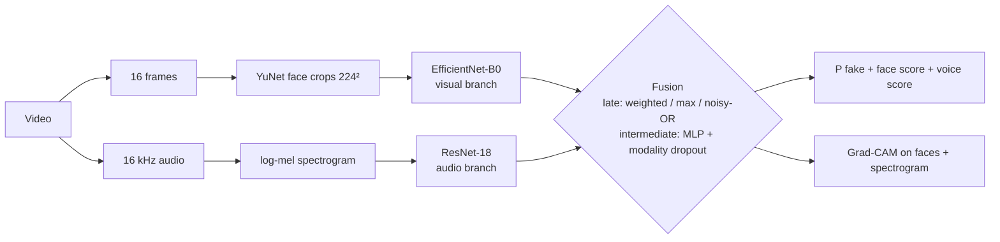
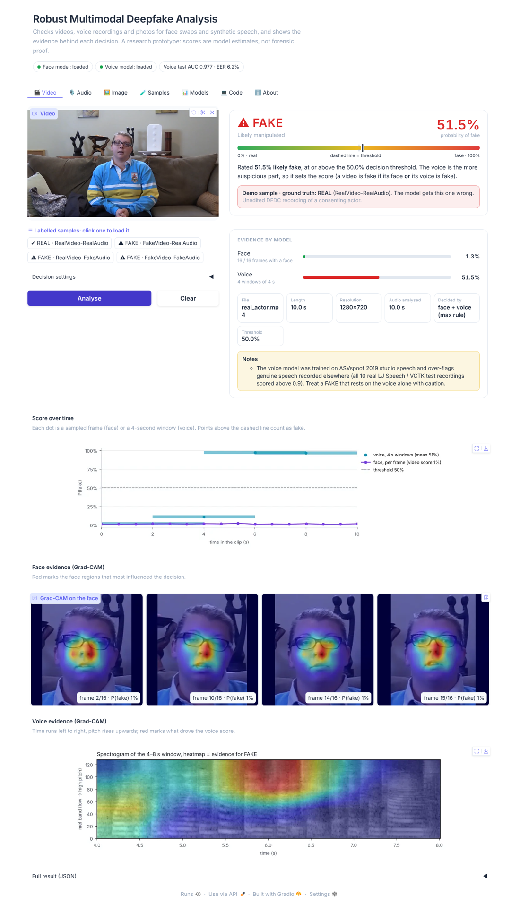

# Robust Multimodal Deepfake Analysis

PyTorch research pipeline for detecting deepfakes in **videos, voice recordings and photos**, using
the **face** and the **voice**, with robustness testing and Grad-CAM heatmaps.

- **Voice model (this project):** ResNet-18 on log-mel spectrograms, trained on ASVspoof 2019 LA
  (test AUC 0.977, EER 6.2%). It does **not** transfer to speech recorded elsewhere: see
  [reports/voice_generalization.md](reports/voice_generalization.md).
- **Face model:** until this project's own face and fusion models are trained (FakeAVCeleb access
  pending), the demo uses the pretrained DFDC-winning EfficientNet-B7 by Selim Seferbekov (MIT).
- **Demo samples:** 4 videos, 4 audio clips and 3 images with ground truth, in [demo_samples/](demo_samples).



**Docs:**
- [PLAN.md](PLAN.md): roadmap.
- [TASKS.md](TASKS.md): task tracker with specs and status.
- [DATASETS.md](DATASETS.md): how to get the data.
- [reports/results.md](reports/results.md): results, generated from actual runs.
- [reports/report.md](reports/report.md): project report draft.
- [reports/presentation_outline.md](reports/presentation_outline.md): slide plan.

## Features

| | |
|---|---|
| **Datasets** | FakeAVCeleb (main, 4 real/fake categories) · DFDC sample · ASVspoof 2019 LA · Celeb-DF v2; download tools, identity-wise splits |
| **Visual branch** | EfficientNet-B0 on YuNet face crops, frame-averaged |
| **Audio branch** | ResNet-18 on log-mel spectrograms, SpecAugment, ASVspoof pre-training |
| **Fusion** | late (weighted / max / noisy-OR, tuned on validation) and intermediate (MLP, modality dropout) |
| **Robustness** | JPEG, H.264, blur, noise, downscaling, MP3, audio noise × 3 severities + missing modality; robust training |
| **Explainability** | Grad-CAM on face frames and spectrogram, also for the fused decision; example gallery |
| **Demo** | Gradio app: upload a video → verdict, face/voice scores, heatmaps |
| **Report** | `python -m deepfake.report` gathers every finished run into `results.md` + figures |

## Quick start

### On your Mac (writing code, running tests, running the demo)
```bash
uv venv --python 3.11 .venv          # or: python3.11 -m venv .venv
source .venv/bin/activate
uv pip install -r requirements.txt   # or: pip install -r requirements.txt
pip install -e .
pytest                               # synthetic workflow and regression tests (needs ffmpeg)
```

### On Google Colab (data, training, evaluation)
Everything runs from one notebook, [`notebooks/deepfake_pipeline.ipynb`](notebooks/deepfake_pipeline.ipynb).
Open it in Colab with a **T4 GPU** and run all cells. Each stage has an on/off switch in §2 and
checks its own inputs, so a stage whose dataset or checkpoint is missing says what is missing and
is skipped instead of crashing the rest.

| § | Stage |
|---|---|
| 1–2 | setup (GPU, Drive, install, optional tests) and settings |
| 3–4 | download, manifests, identity-wise splits; face crops, spectrograms, waveforms |
| 5 | face model (EfficientNet-B0) |
| 6 | voice model: ASVspoof pre-training, FakeAVCeleb fine-tuning, ablation |
| 7 | late + intermediate fusion and the comparison table |
| 8 | robustness stress test and robust fine-tuning |
| 9 | Grad-CAM gallery |
| 10 | pretrained models on the demo samples |
| 11 | report and the demo app with a public link |

The notebook is generated by `scripts/make_notebooks.py`: edit that script, then re-run it.

## Trained models

| Model | Training data | Test result | Folder |
|---|---|---|---|
| Voice (ResNet-18, log-mel) | ASVspoof 2019 LA, balanced subset (5,000 clips per split) | AUC 0.977 · EER 6.2% on the official evaluation partition (n = 5,000) | [`models/audio_asvspoof_3a53cf51`](models/audio_asvspoof_3a53cf51) |
| Face (EfficientNet-B0) | FakeAVCeleb | pending dataset access | – |
| Face + voice fusion | FakeAVCeleb | pending dataset access | – |
| *Pretrained face model (external)* | DFDC, by Selim Seferbekov, MIT licence | winner of the Kaggle DFDC (2020); one of its 7 ensemble networks | [`models/face_dfdc_effb7`](src/deepfake/face_model.py) |

Each model folder holds its training config, split sizes, per-epoch history, test metrics,
per-category results, every test prediction and the training/ROC figures. The weights are too
large for git: the voice model (134 MB) is attached to this repo's
[GitHub Release](https://github.com/tanishq1101/robust-multimodal-deepfake/releases/tag/model-audio-asvspoof-v1),
the face model (267 MB) is fetched from the DFDC solution's own release:
```bash
python scripts/download_model.py          # downloads and SHA-256-verifies both
```
The external face checkpoint is loaded with `torch.load(weights_only=True)`, so it cannot run code.

**Out-of-domain check.** On 95 clips from the VITS paper (10 genuine LJ Speech / VCTK recordings,
85 synthetic) the voice model scores AUC 0.59 and calls all 10 genuine recordings fake
([reports/voice_generalization.md](reports/voice_generalization.md),
`python scripts/eval_voice_generalization.py`). It learned traits of the ASVspoof recordings,
not of voices in general. Fixing that needs more varied genuine speech in training and an
out-of-domain test set; until then the app flags verdicts that rest on the voice alone.

## Demo
```bash
python scripts/download_model.py          # once
python app/app.py                         # http://127.0.0.1:7860
python app/app.py --share                 # public link (Colab)
python -m deepfake.analyze clip.mp4 --out result/   # command line: JSON + timeline + Grad-CAM images
python -m deepfake.analyze --samples      # every demo sample against its ground truth
```


| Tab | What it does |
|---|---|
| **Video** | Face model on 16 frames + voice model on 4 s windows of the soundtrack. Verdict with a probability gauge, both scores, a score-over-time chart, Grad-CAM on faces and on the spectrogram. *Decision settings*: threshold, and whether the verdict uses face + voice (max rule), face only or voice only. |
| **Audio** | Upload or record speech: per-window scores, spectrogram Grad-CAM. |
| **Image** | The most prominent face is detected, boxed and scored, with Grad-CAM. |
| **Samples** | All labelled demo clips in one table against their ground truth. |
| **Models** | What each model is, its training data, metrics, confusion matrix, per-attack results, curves and ROC. |
| **Code / About** | Training command and key source; how to read the results, limitations, sources. |

Each tab has the labelled samples one click away; their ground truth is shown next to the verdict,
including the cases the models get wrong. Result on the 11 samples at threshold 0.5:
**9 / 11 correct** ([reports/demo_samples/results.md](reports/demo_samples/results.md)). The two
errors are both the voice model calling genuine speech fake: the real LJ Speech recording, and
the real DFDC video, where a voice score of 0.515 tips the max rule. With *face only* that video
is judged REAL.

It returns `INCONCLUSIVE` when nothing can be judged (no face in a photo, a silent clip). It is
a research prototype: scores are model estimates, not forensic proof.

## Command-line tools
```bash
python -m deepfake.data.download status            # what's downloaded
python -m deepfake.data.download asvspoof          # dfdc | asvspoof | fakeavceleb | celebdf
python -m deepfake.data.manifest all               # unified CSV per dataset
python -m deepfake.data.splits dfdc                # identity-wise train/val/test
python -m deepfake.preprocessing.run dfdc          # faces + spectrograms + waveforms
python -m deepfake.training.train_visual --dataset dfdc                       # resumable training
python -m deepfake.training.train_audio --dataset asvspoof
python -m deepfake.training.train_audio --dataset fakeavceleb --init-from <run>/best.pt
python -m deepfake.training.train_fusion --fusion late --visual-ckpt V.pt --audio-ckpt A.pt   # or intermediate
python -m deepfake.evaluation.compare --dataset fakeavceleb --model visual_only=V.pt --model late=L.pt
python -m deepfake.evaluation.robustness_eval --label overall --limit 300 --model fused=F.pt
python -m deepfake.evaluation.evaluate --checkpoint <run>/best.pt --dataset celebdf      # cross-dataset
python -m deepfake.explainability.gallery --checkpoint F.pt --dataset fakeavceleb
python -m deepfake.report --out reports            # results.md + figures from all runs
python -m deepfake.analyze clip.mp4 --out result/  # any video, audio or image file
python scripts/make_demo_samples.py                # rebuild demo_samples/ from the sources
python scripts/eval_voice_generalization.py        # voice model on out-of-domain speech
cd scripts/presentation && npm install && npm run build   # reports/presentation.pptx from models/
```
Add `--robust-augment` to any training command for robust training.

## Project layout
```
configs/default.yaml      all settings (frames, image size, audio params, training)
src/deepfake/
  config.py               config + Mac/Colab path resolution
  data/                   download.py · manifest.py · splits.py
  preprocessing/          frames.py · faces.py (YuNet) · audio.py · run.py (faces + mel + wav)
  datasets/               PyTorch datasets (visual / audio / multimodal, degradation hooks)
  models/                 visual.py · audio.py · fusion.py
  training/               engine.py · tasks.py · runner.py · train_visual.py · train_audio.py · train_fusion.py
  evaluation/             metrics.py · evaluate.py · compare.py · robustness_eval.py · plots.py
  robustness/             degradations.py
  explainability/         gradcam.py · gallery.py
  inference.py            single-file analysis with a project checkpoint + CLI
  face_model.py           pretrained DFDC face-swap detector (EfficientNet-B7), Grad-CAM
  analyzer.py             video / audio / image analysis used by the app; analyze.py is its CLI
  model_card.py           reads a run folder (config, data, metrics, history) for the demo
  demo.py                 Gradio UI
  report.py               results.md + figures from all runs
app/app.py                demo launcher
demo_samples/             labelled demo videos, audio and images (sources in its README)
models/                   published trained models: run files in git, weights via scripts/download_model.py
notebooks/                deepfake_pipeline.ipynb, the whole project in one Colab notebook
reports/                  results.md (generated) · report.md · presentation.pptx · presentation_outline.md · figures/
scripts/presentation/     deck generator (Node: pptxgenjs)
tests/                    pytest suite
```

## Status
All code (Phases 0–8) is implemented and tested. The voice model has been trained on ASVspoof
2019 LA on a Colab T4 (see [Trained models](#trained-models) and
[reports/report.md](reports/report.md) §6.2). The face, fusion, robustness and Grad-CAM runs on
real data are pending FakeAVCeleb access. Detailed checklist: [TASKS.md](TASKS.md). See
[reports/review.md](reports/review.md) for the code review, fixes, and verification limits.

- [x] Phase 0: project setup
- [x] Phase 1: data pipeline (waiting on dataset access)
- [x] Phase 2: visual branch
- [x] Phase 3: audio branch
- [x] Phase 4: multimodal fusion
- [x] Phase 5: robustness
- [x] Phase 6: explainability
- [x] Phase 7: demo app
- [x] Phase 8: report tooling and drafts (final numbers and PPT after the training runs)

## Datasets and citations
FakeAVCeleb, DFDC, ASVspoof 2019 and Celeb-DF are used under their own licences and access terms.
See [DATASETS.md](DATASETS.md); papers are listed in [reports/report.md](reports/report.md#references).
