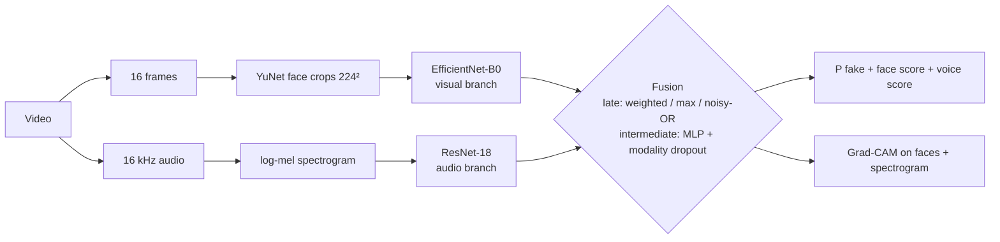

# Robust Multimodal Deepfake Analysis

PyTorch research pipeline for detecting deepfake videos using the **face** (video) and the
**voice** (audio), with robustness testing and Grad-CAM heatmaps. The software is tested on
synthetic data; real-dataset training and detection accuracy have not yet been verified.



**Docs:**
- [PLAN.md](PLAN.md): roadmap.
- [TASKS.md](TASKS.md): task tracker with specs and status.
- [DATASETS.md](DATASETS.md): how to get the data.
- [reports/results.md](reports/results.md): results, generated from actual runs.
- [reports/report.md](reports/report.md): project report draft.
- [reports/presentation_outline.md](reports/presentation_outline.md): slide plan.

## Features

| | |
|---|---|
| **Datasets** | FakeAVCeleb (main, 4 real/fake categories) · DFDC sample · ASVspoof 2019 LA · Celeb-DF v2; download tools, identity-wise splits |
| **Visual branch** | EfficientNet-B0 on YuNet face crops, frame-averaged |
| **Audio branch** | ResNet-18 on log-mel spectrograms, SpecAugment, ASVspoof pre-training |
| **Fusion** | late (weighted / max / noisy-OR, tuned on validation) and intermediate (MLP, modality dropout) |
| **Robustness** | JPEG, H.264, blur, noise, downscaling, MP3, audio noise × 3 severities + missing modality; robust training |
| **Explainability** | Grad-CAM on face frames and spectrogram, also for the fused decision; example gallery |
| **Demo** | Gradio app: upload a video → verdict, face/voice scores, heatmaps |
| **Report** | `python -m deepfake.report` gathers every finished run into `results.md` + figures |

## Quick start

### On your Mac (writing code, running tests, running the demo)
```bash
uv venv --python 3.11 .venv          # or: python3.11 -m venv .venv
source .venv/bin/activate
uv pip install -r requirements.txt   # or: pip install -r requirements.txt
pip install -e .
pytest                               # synthetic workflow and regression tests (needs ffmpeg)
```

### On Google Colab (data, training, evaluation)
The notebooks clone this repo automatically. Run them in order with a **T4 GPU** runtime:

| Notebook | Phase | What it does |
|---|---|---|
| `00_colab_setup` | 0 | GPU check, install, tests |
| `01_download_datasets` | 1 | downloads, manifests, identity-wise splits |
| `02_preprocess` | 1 | face crops, spectrograms, waveforms → Google Drive |
| `03_train_visual` | 2 | visual branch |
| `04_train_audio` | 3 | audio branch (ASVspoof pre-training → FakeAVCeleb) |
| `05_train_fusion` | 4 | late + intermediate fusion, comparison table |
| `06_robustness` | 5 | stress tests, robust fine-tuning |
| `07_explainability` | 6 | Grad-CAM gallery |
| `08_demo_and_report` | 7–8 | build the report, launch the demo with a public link |

Notebooks are generated by `scripts/make_notebooks.py`. Edit that script, then re-run it.

## Demo
```bash
python app/app.py                         # uses the best checkpoint in <data_root>/checkpoints
python app/app.py --checkpoint best.pt --share
python -m deepfake.inference clip.mp4 --out result/     # command line: JSON + explanation.png
```
The app warns when no face is found or the clip has no audio. It is a research prototype: scores
are model estimates, not forensic proof.
It returns `INCONCLUSIVE` with no probability when the model's required evidence is absent.

## Command-line tools
```bash
python -m deepfake.data.download status            # what's downloaded
python -m deepfake.data.download asvspoof          # dfdc | asvspoof | fakeavceleb | celebdf
python -m deepfake.data.manifest all               # unified CSV per dataset
python -m deepfake.data.splits dfdc                # identity-wise train/val/test
python -m deepfake.preprocessing.run dfdc          # faces + spectrograms + waveforms
python -m deepfake.training.train_visual --dataset dfdc                       # resumable training
python -m deepfake.training.train_audio --dataset asvspoof
python -m deepfake.training.train_audio --dataset fakeavceleb --init-from <run>/best.pt
python -m deepfake.training.train_fusion --fusion late --visual-ckpt V.pt --audio-ckpt A.pt   # or intermediate
python -m deepfake.evaluation.compare --dataset fakeavceleb --model visual_only=V.pt --model late=L.pt
python -m deepfake.evaluation.robustness_eval --label overall --limit 300 --model fused=F.pt
python -m deepfake.evaluation.evaluate --checkpoint <run>/best.pt --dataset celebdf      # cross-dataset
python -m deepfake.explainability.gallery --checkpoint F.pt --dataset fakeavceleb
python -m deepfake.report --out reports            # results.md + figures from all runs
```
Add `--robust-augment` to any training command for robust training.

## Project layout
```
configs/default.yaml      all settings (frames, image size, audio params, training)
src/deepfake/
  config.py               config + Mac/Colab path resolution
  data/                   download.py · manifest.py · splits.py
  preprocessing/          frames.py · faces.py (YuNet) · audio.py · run.py (faces + mel + wav)
  datasets/               PyTorch datasets (visual / audio / multimodal, degradation hooks)
  models/                 visual.py · audio.py · fusion.py
  training/               engine.py · tasks.py · runner.py · train_visual.py · train_audio.py · train_fusion.py
  evaluation/             metrics.py · evaluate.py · compare.py · robustness_eval.py · plots.py
  robustness/             degradations.py
  explainability/         gradcam.py · gallery.py
  inference.py            single-file analysis (video or audio) + CLI
  demo.py                 Gradio UI
  report.py               results.md + figures from all runs
app/app.py                demo launcher
notebooks/                Colab runners (generated by scripts/make_notebooks.py)
reports/                  results.md (generated) · report.md · presentation_outline.md · figures/
tests/                    pytest suite
```

## Status
All code (Phases 0–8) is implemented and tested on synthetic data. The training runs on the
real datasets are pending dataset access. Detailed checklist: [TASKS.md](TASKS.md).
The notebooks contain training commands, not completed training results. See
[reports/review.md](reports/review.md) for the code review, fixes, and verification limits.

- [x] Phase 0: project setup
- [x] Phase 1: data pipeline (waiting on dataset access)
- [x] Phase 2: visual branch
- [x] Phase 3: audio branch
- [x] Phase 4: multimodal fusion
- [x] Phase 5: robustness
- [x] Phase 6: explainability
- [x] Phase 7: demo app
- [x] Phase 8: report tooling and drafts (final numbers and PPT after the training runs)

## Datasets and citations
FakeAVCeleb, DFDC, ASVspoof 2019 and Celeb-DF are used under their own licences and access terms.
See [DATASETS.md](DATASETS.md); papers are listed in [reports/report.md](reports/report.md#references).
