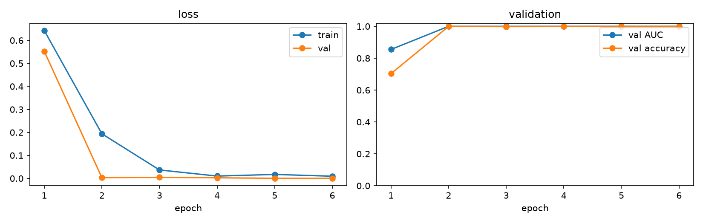

# Results

_Generated by `python -m deepfake.report` on 2026-10-11 from the `deepfake_project` data folder. Every number below comes from a saved run; missing sections have not been run yet._

## Setup

| Item | Value |
|---|---|
| Frames per video | 16 uniform · 224² YuNet face crops (margin 1.3) |
| Audio | 16 kHz · 128-bin log-mel · 4 s window |
| Splits | identity-wise, val 15% / test 15% (official splits kept for ASVspoof and the Celeb-DF test list) |
| Seed | 42 |

## Datasets

| dataset   | split   |   clips |   fake |   real |
|:----------|:--------|--------:|-------:|-------:|
| asvspoof  | train   |    5000 |   2500 |   2500 |
| asvspoof  | val     |    5000 |   2500 |   2500 |
| asvspoof  | test    |    5000 |   2500 |   2500 |

## Training runs (test split of the training dataset)

| run                     | task   | dataset   | fusion   | robust   | pretrained_from   |   epochs |   best_epoch |   test_n |   test_auc |   test_eer |   test_acc |   test_f1 |
|:------------------------|:-------|:----------|:---------|:---------|:------------------|---------:|-------------:|---------:|-----------:|-----------:|-----------:|----------:|
| audio_asvspoof_3a53cf51 | audio  | asvspoof  |          | False    |                   |        6 |            3 |     5000 |     0.9771 |     0.0620 |     0.9124 |    0.9048 |

## Phase 2: Visual branch

_Not run yet._

## Phase 3: Audio branch

### `audio_asvspoof_3a53cf51`

Test AUC **0.9771** · EER 0.0620 · accuracy 0.9124 · F1 0.9048 (n = 5000, best epoch 3)

Per category:

| category   |    n |   fake_fraction |   mean_score |   accuracy | auc_vs_real        | eer_vs_real          |
|:-----------|-----:|----------------:|-------------:|-----------:|:-------------------|:---------------------|
| A07        |  194 |          1.0000 |       0.9999 |     1.0000 | 0.9999876288659795 | 0.0006               |
| A08        |  182 |          1.0000 |       0.9999 |     1.0000 | 0.999965934065934  | 0.0008               |
| A09        |  189 |          1.0000 |       0.9998 |     1.0000 | 0.999989417989418  | 0.001                |
| A10        |  209 |          1.0000 |       0.6736 |     0.6938 | 0.9851358851674641 | 0.051915789473684235 |
| A11        |  197 |          1.0000 |       0.9946 |     1.0000 | 0.9997279187817258 | 0.007876142131979711 |
| A12        |  205 |          1.0000 |       0.7664 |     0.7951 | 0.9914585365853659 | 0.042951219512195146 |
| A13        |  204 |          1.0000 |       0.6024 |     0.6422 | 0.9887656862745098 | 0.04405882352941174  |
| A14        |  182 |          1.0000 |       0.9989 |     1.0000 | 0.9999384615384616 | 0.004547252747252737 |
| A15        |  189 |          1.0000 |       0.9351 |     0.9418 | 0.997910052910053  | 0.021382010582010582 |
| A16        |  178 |          1.0000 |       0.9995 |     1.0000 | 0.9999101123595506 | 0.0008               |
| A17        |  171 |          1.0000 |       0.0322 |     0.0117 | 0.7248491228070175 | 0.343714619883041    |
| A18        |  207 |          1.0000 |       0.6896 |     0.7150 | 0.9883574879227054 | 0.048954589371980675 |
| A19        |  193 |          1.0000 |       0.9934 |     0.9948 | 0.9988290155440415 | 0.003990673575129543 |
| bonafide   | 2500 |          0.0000 |       0.0118 |     0.9924 |                    |                      |

_ROC curve: `MyDrive/deepfake_project/report/figures/audio_asvspoof_3a53cf51_roc.png` (not copied to the repository)._

## Phase 4: Fusion models

_Not run yet._

## Phase 4: Model comparison (overall label, same test set)

_Not run yet._

## Phase 5: Robustness

_Not run yet._

## Phase 6: Explainability (Grad-CAM)

_Not run yet._

## Observations

_Write your observations in `observations.md` next to this file; they are included here._
